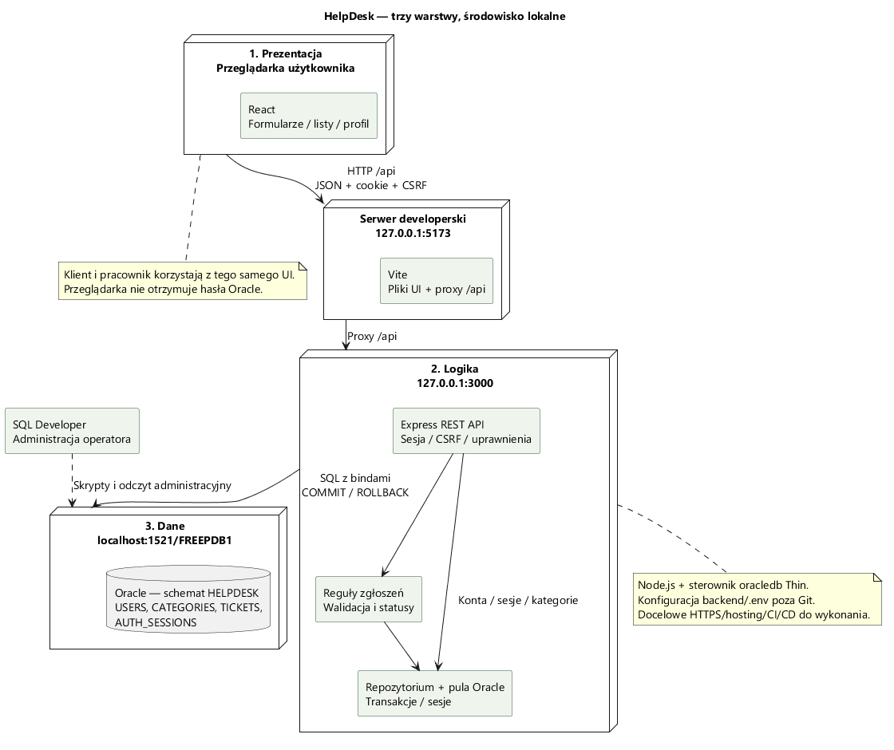
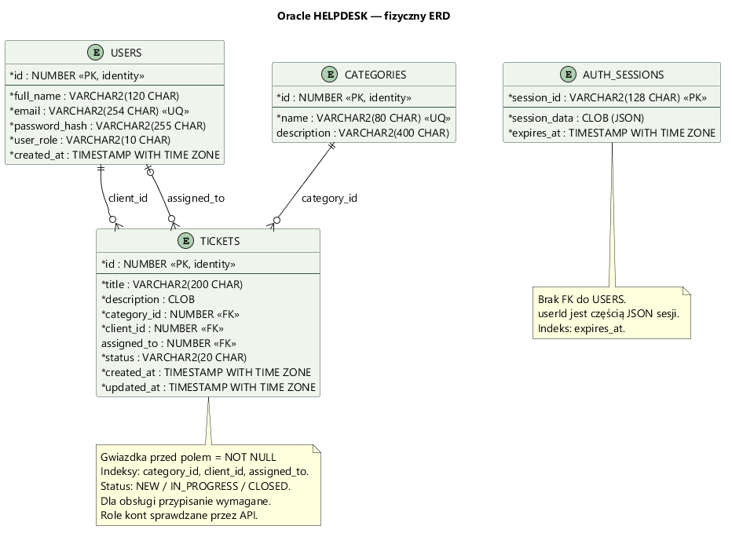

# Architektura i model danych HelpDesk

Stan bazowy po APP-04, dokumentacja DOC-01 z 12.10.2026. Diagramy opisują działającą aplikację lokalną. Docelowe wdrożenie jest osobną pracą.

## Trzy warstwy



| Warstwa | Odpowiedzialność | Kod |
|---|---|---|
| Prezentacja — React | Formularze, nawigacja, listy, komunikaty, profil, wywołania HTTP | `frontend/src/App.jsx`, `components/`, `api.js`, `styles.css` |
| Logika — Express | Sesja, CSRF, uprawnienia, walidacja, reguły statusów, REST API | `backend/src/app.js`, `auth.js`, `tickets.js`, `ticket-rules.js` |
| Dane — Oracle | Trwały zapis kont, kategorii, zgłoszeń i sesji; klucze, ograniczenia, indeksy | `database/`, `backend/src/database.js`, `ticket-repository.js`, `session-store.js` |

Przeglądarka wysyła JSON pod `/api`. Podczas pracy lokalnej Vite przekazuje te żądania do Express na porcie 3000. Express korzysta z puli połączeń Oracle przez sterownik w trybie Thin. SQL Developer jest narzędziem operatora do wykonywania skryptów i przeglądania bazy; nie jest częścią ścieżki żądania klienta aplikacji.

Frontend nie zna hasła Oracle. `backend/.env` jest konfiguracją lokalną pomijaną przez Git. Konta `CLIENT`/`STAFF` znajdują się w tabeli `USERS`; połączenie backendu ze schematem `HELPDESK` jest odrębnym kontem bazy.

## Podział kodu

```text
helpdesk/
  frontend/src/
    App.jsx                 sesja i nawigacja
    api.js                  HTTP, cookie i CSRF
    components/AuthForm.jsx rejestracja i logowanie
    components/Dashboard.jsx panel, kategorie i profil
    components/Tickets.jsx  lista, formularz i obsługa zgłoszenia
  backend/src/
    server.js               start, kontrola schematu, zatrzymanie
    app.js                  Express, middleware i trasy wspólne
    auth.js                 konta, sesja i role
    passwords.js            scrypt
    validation.js           formularze kont
    tickets.js              trasy zgłoszeń
    ticket-rules.js          walidacja i reguły biznesowe
    ticket-repository.js     zapytania i zmiany zgłoszeń
    database.js             pula, wykonanie SQL i transakcje
    session-store.js         magazyn sesji Oracle
  database/                 schemat, dane początkowe i migracja
  docs/                     wymagania, projekt i dowody odbioru
```

To rozdzielenie odpowiedzialności w modułach JavaScript. [Diagram klas](use-cases.md#model-dziedziny) przedstawia model pojęciowy danych, a nie deklaracje klas, których kod nie posiada.

## ERD — rzeczywiste tabele



| Tabela | Klucz i dane | Reguły |
|---|---|---|
| `USERS` | `id` PK/identity; `full_name`, `email`, `password_hash`, `user_role`, `created_at` | Unikalny i znormalizowany e-mail; rola `CLIENT` lub `STAFF`; hash zamiast hasła |
| `CATEGORIES` | `id` PK/identity; `name`, opcjonalne `description` | Unikalna nazwa; cztery kategorie początkowe |
| `TICKETS` | `id` PK/identity; tytuł, opis CLOB, kategoria, klient, opcjonalny pracownik, status, daty | Trzy FK; dopuszczalne statusy; przypisanie wymagane po rozpoczęciu obsługi |
| `AUTH_SESSIONS` | `session_id` PK; `session_data` CLOB, `expires_at` | JSON sesji, czas wygaśnięcia; indeks czasu wygaśnięcia |

Relacje fizyczne:

- Jedna kategoria ma 0..* zgłoszeń; każde zgłoszenie ma jedną kategorię.
- Jedno konto ma 0..* zgłoszeń jako klient; każde zgłoszenie ma jednego właściciela przez `client_id`.
- Jedno konto ma 0..* przypisanych zgłoszeń; zgłoszenie ma 0..1 prowadzącego przez `assigned_to`.

FK wskazują `USERS.id` i nie kontrolują roli konta. Wymóg klienta/wskazanego pracownika sprawdza API. `AUTH_SESSIONS` nie ma FK do `USERS`: identyfikator konta jest częścią JSON sesji, a bieżący profil i rola są odczytywane przez backend. Powiązania tego nie przedstawiamy jako fizycznej relacji ERD.

Trzy indeksy dla FK zgłoszeń wspomagają odczyt po kategorii, kliencie i pracowniku. Datę `updated_at` ustawia backend podczas zapisu. Nie ma wyzwalacza automatycznie zmieniającego tę datę. Dokładne typy, ograniczenia i kolejność instalacji: [instrukcja bazy](../database/README.md), [schemat domeny](../database/01_schema.sql), [sesje](../database/04_auth_sessions.sql).

## Kontrakt API i przepływ zapisu

API używa HTTP i JSON. Odczyty są GET, utworzenie POST, zmiana PATCH, usunięcie DELETE. Sesja jest przekazywana przez cookie `helpdesk.sid`; operacje zapisu wymagają nagłówka `X-CSRF-Token`. Szczegółowe trasy, przykłady i błędy znajdują się w [opisie kont](authentication.md), [opisie zgłoszeń](tickets.md) i [backendzie](../backend/README.md). Specyfikacja w formacie do importu do Postmana/Swaggera pozostaje kolejnym zadaniem.

PATCH/DELETE korzystają z jednej transakcji: dostępny rekord jest blokowany przez `FOR UPDATE WAIT 3`, wersja i stan są sprawdzane, następnie następuje zapis i COMMIT. Błąd powoduje ROLLBACK. `revision` odpowiada tekstowi UTC z `updated_at` z dokładnością do mikrosekund; frontend przesyła go bez konwersji. Nieaktualna wersja daje 409. [Diagram sekwencji](use-cases.md#sekwencje) pokazuje zapis pracownika.

Sesje przechowywane w Oracle umożliwiają odczyt po restarcie API, o ile zachowany jest klucz sesji i sesja nie wygasła. Limity prób logowania są obecnie w pamięci jednego procesu. Przy wielu instancjach wymagają współdzielonego magazynu.

## Decyzje techniczne

| Decyzja projektu | Powód | Konsekwencja |
|---|---|---|
| HelpDesk dla małego serwisu | Dwie czytelne role, relacje i pełny CRUD | Zakres da się zademonstrować jednym scenariuszem |
| React + Vite + Bootstrap | Istniejący frontend i formularze; React w wymaganiach zajęć | Osobny build statyczny i API podczas developmentu |
| Node.js + Express | Jeden język w UI i logice; technologia dopuszczona w materiale | Walidacja i uprawnienia wykonywane na serwerze |
| Oracle + SQL Developer | Dostępne środowisko studenta i nauka SQL na innych zajęciach | Hosting musi zapewnić połączenie z Oracle |
| Sesja cookie + CSRF | Konta przez przeglądarkę i współdzielony magazyn sesji | Frontend i API najlepiej pod jednym adresem |
| Jeden projekt na `main` | Realizuje go student z zespołem umownym | Małe commity i jawny przegląd, bez fikcyjnych autorów |

PDF określa etapy projektu i rodzaje rezultatów. Wybór Oracle, sposób sesji i reguły HelpDesk należą do tego projektu.

## Środowiska i dalsze wdrożenie

| Środowisko | Stan | Adresy / warunki |
|---|---|---|
| Lokalne deweloperskie | Działa | React `127.0.0.1:5173`, Express `127.0.0.1:3000`, Oracle `localhost:1521/FREEPDB1` |
| Automatyczne testy jednostkowe/UI | Działa | Baza testowa i jsdom; niezależne od rzeczywistego Oracle |
| Integracja lokalna | Sprawdzona w APP-04 | Tymczasowe serwery HTTP i rzeczywisty Oracle; własne dane testowe są sprzątane |
| Zdalne testowe/produkcyjne | Do wykonania | Hosting Node, Oracle dostępny dla API, HTTPS, sekrety, wspólny adres UI/API, CI/CD |

Docelowy plan: reverse proxy HTTPS serwuje build React i przekazuje `/api` do Express. Dopiero wtedy ustawiamy konfigurację produkcyjną i właściwe zaufanie do proxy. Nie traktujemy lokalnego Vite ani samego statycznego hostingu jako zakończonego wdrożenia aplikacji. Wybór platformy, pipeline, monitoring, kopie i procedura odtworzenia pozostają w [planie projektu](project-plan.md).
