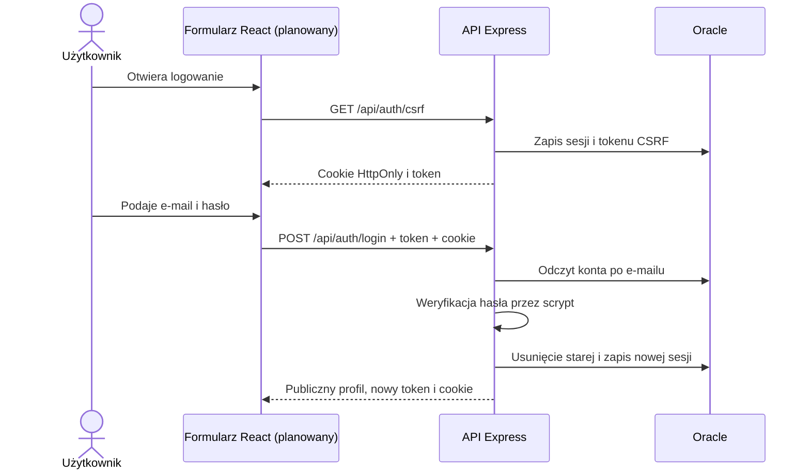

# Rejestracja, logowanie i role HelpDesk

Etap APP-02, stan na 2026-10-12. Dokument opisuje działający backend. Formularze React będą korzystać z tego API w kolejnym etapie.

## Wymagania i przypadki użycia

| ID | Aktor | Wymaganie i wynik |
|---|---|---|
| AUTH-01 | Gość | Rejestruje konto, podając imię i nazwisko, e-mail oraz hasło. Powstaje `CLIENT`. |
| AUTH-02 | Klient lub pracownik | Loguje się e-mailem i hasłem. Dostaje nową sesję oraz publiczny profil. |
| AUTH-03 | Zalogowany użytkownik | Odczytuje swój profil i rolę przez `/me`. |
| AUTH-04 | Zalogowany użytkownik | Wylogowuje się. Usunięte cookie nie pozwala ponownie użyć starej sesji. |
| AUTH-05 | Pracownik | Odczytuje podsumowanie liczby klientów i zgłoszeń. Klient otrzymuje 403. |
| AUTH-06 | Osoba zarządzająca lokalną instalacją | Tworzy konto pracownika poleceniem `staff:create`. |

Hasło ma 12–128 znaków, a imię i nazwisko 2–120. E-mail jest przycinany, zamieniany na małe litery i sprawdzany przed zapisem. Hasło nie jest przycinane. Backend odrzuca nieznane pola formularza, w tym żądanie samodzielnego nadania roli `STAFF`.

## Przepływ formularzy

1. Pobierz `GET /api/auth/csrf`. Serwer zwraca `{ "csrfToken": "..." }` i cookie `helpdesk.sid`.
2. Przy `POST` prześlij JSON, cookie sesji oraz nagłówek `X-CSRF-Token` z otrzymanym tokenem.
3. Rejestracja zwraca 201, ale nie loguje automatycznie. Formularz może przekierować na logowanie.
4. Po logowaniu zachowaj nowy token z odpowiedzi; serwer również zmienia identyfikator cookie. Poprzedni token nie pasuje do nowej sesji.
5. Odczyt `/me` pozwala zdecydować, czy pokazać panel klienta, czy pracownika. Backend sprawdza rolę także przy każdym chronionym żądaniu.
6. Wylogowanie wymaga aktualnego tokenu CSRF i zwraca 204 bez treści.

Przy frontendzie i API pod tym samym adresem przeglądarka obsługuje cookie. `fetch` powinien używać `credentials: 'same-origin'`. Cookie jest `HttpOnly`; kod React nie odczytuje jego wartości. Token CSRF przechowujemy w pamięci aplikacji. Interfejs nie przesyła roli użytkownika w formularzu rejestracji.



## Kontrakt API

Rejestracja: `POST /api/auth/register`

```json
{
  "fullName": "Jan Kowalski",
  "email": "jan@example.com",
  "password": "Przykladowe haslo 123"
}
```

Logowanie: `POST /api/auth/login`

```json
{
  "email": "jan@example.com",
  "password": "Przykladowe haslo 123"
}
```

Odpowiedź rejestracji i `/me` ma obiekt `user` z polami `id`, `fullName`, `email`, `role`. Odpowiedź logowania dodatkowo zawiera `csrfToken`. Żadna z nich nie zawiera `passwordHash` ani hasła. Role mają wartości `CLIENT` lub `STAFF`.

`GET /api/staff/summary` zwraca np. `{ "data": { "clients": 3, "tickets": 5 } }`. To pierwsza funkcja chroniona rolą pracownika, przygotowana do późniejszego panelu.

| HTTP | Kod błędu | Znaczenie |
|---|---|---|
| 400 | `INVALID_INPUT` / `INVALID_JSON` | Niepoprawny formularz lub JSON |
| 401 | `INVALID_CREDENTIALS` | Nieprawidłowy e-mail lub hasło; komunikat jest taki sam dla nieznanego konta |
| 401 | `AUTH_REQUIRED` | Brak aktywnej sesji |
| 403 | `CSRF_INVALID` | Brak lub niepoprawny token formularza |
| 403 | `FORBIDDEN` | Brak roli pracownika |
| 409 | `EMAIL_EXISTS` | E-mail jest już zajęty |
| 413 | `BODY_TOO_LARGE` | JSON przekracza 16 KB |
| 429 | `TOO_MANY_ATTEMPTS` | Przekroczony limit prób na IP |
| 503 | `DATABASE_UNAVAILABLE` | Awaria Oracle bez ujawniania szczegółów połączenia |
| 500 | `INTERNAL_ERROR` | Nieoczekiwany błąd serwera |

Błędy mają format `{ "error": "KOD", "message": "Komunikat" }`. Odpowiedzi uwierzytelniania mają `Cache-Control: no-store`.

## Architektura i dane

- `app.js` konfiguruje Express, JSON, cookie, sesje oraz obsługę błędów.
- `auth.js` obsługuje formularze, CSRF, logowanie, wylogowanie i kontrolę dostępu.
- `passwords.js` używa asynchronicznego scrypt: N=32768, r=8, p=3, losowa sól 16 bajtów i wynik 64 bajty. Porównanie wyniku używa `timingSafeEqual`. Dla nieznanego konta również wykonywane jest haszowanie.
- `database.js` wykonuje zapytania z parametrami wiązanymi i zamyka połączenia w `finally`.
- `session-store.js` przechowuje sesje w `AUTH_SESSIONS` i obsługuje ich odczyt, zapis, odnowienie oraz usunięcie.

Sesja zawiera `userId`, token CSRF i ustawienia cookie. Role są pobierane z `USERS` przy każdym chronionym żądaniu, więc zmiana roli działa bez ponownego logowania. Sesja wygasa po godzinie braku aktywności. Odnowienie aktualizuje wyłącznie istniejący, niewygasły rekord; nie odtwarza sesji usuniętej podczas wylogowania.

`SESSION_SECRET` podpisuje cookie i pozostaje lokalny. Trzeba używać tego samego klucza we wszystkich instancjach obsługujących wspólne sesje. Na hostingu wymagane są HTTPS i cookie `Secure`; konfigurację proxy opisuje `backend/README.md`.

## Sprawdzenie etapu

`npm.cmd test`: 22 testy jednostkowe i HTTP, w tym haszowanie, role, CSRF, duplikaty, limit prób, wygasanie sesji, zmiana roli, format JSON i brak szczegółów błędów.

`npm.cmd run test:oracle`: rzeczywisty zapis i odczyt kont oraz sesji w Oracle, poprawne logowanie, blokada klienta w panelu pracownika, współdzielenie sesji między dwoma serwerami oraz unieważnienie sesji po wylogowaniu. Skrypt usuwa własne dane testowe.

Testy nie zastępują późniejszych testów formularzy React, obsługi zgłoszeń, wydajności ani konfiguracji docelowego hostingu. Pełna dokumentacja projektu będzie rozwijana wraz z tymi etapami.

## Źródła decyzji technicznych

- [OWASP: przechowywanie haseł i parametry scrypt](https://cheatsheetseries.owasp.org/cheatsheets/Password_Storage_Cheat_Sheet.html)
- [Node.js: asynchroniczne scrypt i timingSafeEqual](https://nodejs.org/docs/latest-v24.x/api/crypto.html)
- [Express: cookie, regeneracja i usuwanie sesji, własny magazyn](https://expressjs.com/en/resources/middleware/session/)
- [OWASP: token CSRF powiązany z sesją](https://cheatsheetseries.owasp.org/cheatsheets/Cross-Site_Request_Forgery_Prevention_Cheat_Sheet.html)
- [Oracle: parametry wiązane zapytań](https://node-oracledb.readthedocs.io/en/latest/user_guide/bind.html)
