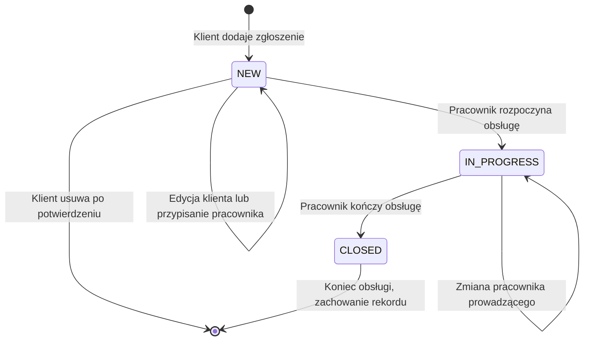

# Zgłoszenia HelpDesk — APP-04

Stan: 2026-10-12. Zaimplementowano obsługę zgłoszeń w React, Express i istniejącym schemacie Oracle `HELPDESK`. Ten etap nie wymaga nowej tabeli ani migracji. Dokument uzupełnia `authentication.md` i `interface.md`.

## Wymagania i uprawnienia

| ID | Wymaganie | Kryterium odbioru |
|---|---|---|
| ZG-01 | Klient tworzy zgłoszenie | Tytuł, opis i istniejąca kategoria zostają zapisane w Oracle; klient i status `NEW` pochodzą z backendu |
| ZG-02 | Klient przegląda własne zgłoszenia | Lista, szczegóły i filtry obejmują wyłącznie jego zgłoszenia; cudzy identyfikator daje 404 |
| ZG-03 | Klient edytuje nowe zgłoszenie | Może zmienić tytuł, opis i kategorię, dopóki status to `NEW` |
| ZG-04 | Klient usuwa nowe zgłoszenie | Potwierdza usunięcie; rekord znika z Oracle i listy; zgłoszeń w obsłudze nie można usunąć |
| ZG-05 | Pracownik zarządza kolejką | Widzi wszystkie zgłoszenia; może przypisać wyłącznie istniejącego pracownika i rozpocząć obsługę |
| ZG-06 | Pracownik kończy obsługę | Status przechodzi `NEW` → `IN_PROGRESS` → `CLOSED`; zamknięte zgłoszenie pozostaje do odczytu |
| ZG-07 | Użytkownik filtruje i stronicuje listę | Filtry: tytuł/kategoria, status, kategoria; dla pracownika dodatkowo przypisane do niego lub nieprzypisane |
| ZG-08 | Zapis nie nadpisuje nieaktualnych danych | Każdy PATCH i DELETE wymaga aktualnej wartości `revision`; konflikt daje 409 i możliwość pobrania danych |

Pracownik zmienia przypisanie i status; treść zgłoszenia należy do klienta. Pracownik nie tworzy i nie usuwa zgłoszeń. Rejestracja publiczna nadal tworzy tylko klientów, a konto pracownika powstaje przez `staff:create`.

Nowe zgłoszenie może pozostać nieprzypisane lub zostać przypisane przed rozpoczęciem obsługi. Przy `IN_PROGRESS` i `CLOSED` pracownik jest wymagany. Cofanie statusów i ponowne otwieranie zamkniętych zgłoszeń nie należą do obecnego zakresu.



## API

Wszystkie trasy wymagają cookie aktywnej sesji. POST, PATCH i DELETE wymagają również `X-CSRF-Token`. Odpowiedzi mają `Cache-Control: no-store`. Reguły są sprawdzane przez backend niezależnie od widocznych przycisków React.

| Metoda i adres | Dostęp | Odpowiedź |
|---|---|---|
| `GET /api/tickets` | Klient: własne; pracownik: wszystkie | 200, `{ data: [...], pagination: {...} }` |
| `GET /api/tickets/:id` | Właściciel lub pracownik | 200, `{ data: ticket }`; 404 dla brakującego/cudzego zgłoszenia |
| `POST /api/tickets` | Klient | 201, `{ data: ticket }` i nagłówek `Location` |
| `PATCH /api/tickets/:id` | Właściciel nowego zgłoszenia lub pracownik | 200, `{ data: ticket }` z nową wersją |
| `DELETE /api/tickets/:id` | Właściciel nowego zgłoszenia | 204, bez treści |
| `GET /api/staff/users` | Pracownik | 200, `{ data: [{ id, fullName }] }` |

Formularz POST:

```json
{
  "title": "Laptop nie uruchamia się",
  "categoryId": 1,
  "description": "Po podłączeniu zasilacza ekran pozostaje czarny."
}
```

Identyfikator kategorii jest przykładem: formularz pobiera rzeczywiste identyfikatory z `/api/categories`. Tytuł ma 3–200 znaków, opis 10–5000; backend przycina początkowe i końcowe spacje. Pola spoza formularza są odrzucane, w tym `clientId`, `status` i `assignedTo` przy tworzeniu. Maksymalna wielkość JSON zgłoszenia wynosi 32 KB; formularze uwierzytelniania zachowują limit 16 KB.

PATCH klienta zawiera te same trzy pola oraz `revision` skopiowane z ostatniego odczytu. PATCH pracownika:

```json
{
  "assignedTo": 2,
  "status": "IN_PROGRESS",
  "revision": "2026-10-12T10:00:00.123456Z"
}
```

DELETE ma treść `{ "revision": "wartość otrzymana z API" }`. `assignedTo: null` jest dopuszczalne tylko dla statusu `NEW`. Nieznana kategoria lub wskazanie klienta jako pracownika powoduje 400.

Rekord zawiera: `id`, `title`, `description`, `categoryId`, `categoryName`, `clientId`, `clientName`, `assignedTo`, `assignedName`, `status`, `createdAt`, `updatedAt`, `revision`. Daty i wersja są tekstem UTC z dokładnością do sześciu miejsc po przecinku. Wersję należy przesyłać dokładnie, bez przeliczania przez JavaScript `Date`.

Parametry GET listy:

| Parametr | Wartości |
|---|---|
| `search` | Do 100 znaków; dosłowne wyszukiwanie fragmentu tytułu lub nazwy kategorii, bez rozróżniania wielkości liter |
| `status` | `NEW`, `IN_PROGRESS`, `CLOSED` lub pominięcie filtra |
| `categoryId` | Dodatnia liczba całkowita |
| `assignment` | `all` (domyślne), `mine`, `unassigned`; filtr ma zastosowanie dla pracownika |
| `page` | 1–100000, domyślnie 1 |
| `pageSize` | 1–50, domyślnie 10 |

Lista jest uporządkowana od najnowszego zgłoszenia, dodatkowo po malejącym ID. `pagination` zawiera `page`, `pageSize`, `total`, `totalPages`; dla pustej listy `totalPages` wynosi 0. Licznik i strona są odczytywane osobnymi zapytaniami, więc przy równoczesnym dodaniu lub usunięciu rekordu ich stan może różnić się chwilowo. Ponowne filtrowanie wraca na pierwszą stronę.

| Kod | Znaczenie |
|---|---|
| `AUTH_REQUIRED` / 401 | Brak aktywnej sesji |
| `FORBIDDEN` / 403 | Czynność niedostępna dla roli |
| `CSRF_INVALID` / 403 | Formularz wymaga świeżego tokenu |
| `INVALID_TICKET` / 400 | Nieprawidłowe pola, filtr, identyfikator lub kolejność statusów |
| `CATEGORY_NOT_FOUND`, `STAFF_NOT_FOUND` / 400 | Nieistniejąca kategoria lub niewłaściwy pracownik |
| `TICKET_NOT_FOUND` / 404 | Zgłoszenie nie istnieje lub jest cudze |
| `TICKET_CHANGED` / 409 | Nieaktualna wersja zgłoszenia |
| `TICKET_LOCKED`, `TICKET_CLOSED` / 409 | Zmiana niedostępna w aktualnym stanie |
| `TICKET_BUSY` / 409 | Trwa zapis innej operacji |
| `DATABASE_UNAVAILABLE` / 503 | Błąd Oracle; bez szczegółów połączenia |

## Transakcje i podział kodu

`tickets.js` obsługuje HTTP, sesję i CSRF. `ticket-rules.js` sprawdza pola, wersję i reguły biznesowe. `ticket-repository.js` wykonuje zapytania Oracle; `database.js` udostępnia transakcję na jednym połączeniu z puli.

Podczas PATCH/DELETE backend blokuje konkretny dostępny użytkownikowi rekord przez `SELECT … FOR UPDATE WAIT 3`. Następnie porównuje wersję, sprawdza stan oraz rolę wskazanego pracownika. Dopiero wtedy zapisuje zmiany i wykonuje COMMIT. Błąd powoduje ROLLBACK. Blokada i sprawdzenie wersji chronią także przed równoczesną edycją klienta i rozpoczęciem obsługi.

`revision` pochodzi z `updated_at`. Każdy zapis ustawia większą wartość: bieżący czas Oracle lub poprzedni czas + 1 mikrosekunda, jeśli bieżący czas nie jest większy. Datę aktualizuje backend; schemat nie zawiera wyzwalacza. Zapytania używają zmiennych wiązanych, a opis CLOB jest odczytywany jako tekst. Uprawnienia i reguły opisane tutaj dotyczą operacji przez API; administracyjny SQL Developer służy do pracy ze schematem.

Blokowanie rekordów i zachowanie `WAIT` opisuje [dokumentacja Oracle SELECT](https://docs.oracle.com/en/database/oracle/oracle-database/19/sqlrf/SELECT.html).

```mermaid
sequenceDiagram
    actor U as Klient lub pracownik
    participant UI as React
    participant API as Express
    participant DB as Oracle
    U->>UI: Zapisz zmiany
    UI->>API: PATCH, cookie, CSRF, revision
    API->>DB: Sprawdź aktywnego użytkownika
    API->>DB: SELECT zgłoszenia FOR UPDATE WAIT 3
    API->>API: Sprawdź właściciela, wersję i stan
    alt Wersja i zmiany poprawne
        API->>DB: UPDATE i odczyt nowego rekordu
        API->>DB: COMMIT
        API-->>UI: 200 i aktualne zgłoszenie
        UI-->>U: Potwierdzenie zapisu
    else Konflikt lub niedozwolona zmiana
        API->>DB: ROLLBACK
        API-->>UI: 400, 404 lub 409
        UI-->>U: Komunikat; szkic pozostaje w formularzu
    end
```

## Sprawdzenie

Z folderu `helpdesk`:

```powershell
npm.cmd --prefix backend test
npm.cmd --prefix frontend test
npm.cmd --prefix frontend run test:integration
npm.cmd run build
```

Sprawdzenie 2026-10-12:

- 29 testów backendu przeszło, w tym 7 nowych testów reguł i tras zgłoszeń.
- 20 testów frontendu przeszło, w tym 8 nowych testów CRUD, filtrów, obsługi pracownika, konfliktów, błędów i komunikacji API.
- Test HTTP przez Vite → Express → rzeczywiste Oracle przeszedł: CRUD, opis CLOB z polskimi znakami i 5000 znakami Unicode, CSRF, izolacja klientów, filtry, paginacja, role, przypisanie, kolejność statusów, wylogowanie i dwa równoczesne zapisy (200 + 409). Własne zgłoszenia, konta i sesje testowe usunięto; serwery testowe zamknięto.
- Build produkcyjny przeszedł. Kontrola wizualna w przeglądarce pozostaje do wykonania; testy DOM i HTTP nie potwierdzają wyglądu.

Scenariusz ręczny: zaloguj klienta, dodaj zgłoszenie, popraw opis, dodaj drugie i usuń je po potwierdzeniu. Zaloguj pracownika, otwórz pierwsze, wybierz „Przypisz do mnie” i status „W trakcie”, zapisz, następnie zamknij. Po powrocie do konta klienta sprawdź status i brak przycisków edycji/usuwania. Sprawdź filtry, działanie klawiaturą i szerokości 1440, 768, 390 px.

## GitHub i Trello

W GitHub Desktop wpisz `APP-04: Dodano zgłoszenia i obsługę serwisu`, wykonaj **Commit to main**, następnie **Push origin**. Na GitHubie otwórz ten konkretny commit i skopiuj adres strony.

W Trello użyj istniejących kart odpowiadających tym pracom albo dodaj kartę **APP-04: Obsługa zgłoszeń**. Umieść ją w „Do sprawdzenia”. Karty opisujące sześć faz projektu pozostają na liście planu. Przypisz do zadania siebie jako osobę odpowiedzialną; podział ról zespołu i terminy uzupełnimy w dokumentacji planowania.

Checklista karty:

- [x] Tworzenie, lista i szczegóły zgłoszeń klienta.
- [x] Edycja i usuwanie własnych nowych zgłoszeń.
- [x] Przypisanie pracownika i zmiana statusów.
- [x] Filtry i paginacja.
- [x] Uprawnienia, CSRF i kontrola wersji.
- [x] Testy automatyczne i połączenie z Oracle.
- [x] Dokumentacja API oraz reguł.
- [ ] Ręczny scenariusz klient → pracownik → klient.
- [ ] Kontrola wyglądu na komputerze i telefonie.

Treść do komentarza po wysłaniu commita:

```text
APP-04: Zaimplementowano zgłoszenia klienta i obsługę pracownika.
Zapis i odczyt działają w Oracle. Backend: 29 testów OK; frontend: 20 testów OK.
Integracja Vite → Express → Oracle i build: OK.
Pozostaje kontrola ręczna działania i wyglądu w przeglądarce.
Commit: [wklej adres konkretnego commita]
```

Po rzeczywistym wykonaniu kontroli ręcznej zaznacz ostatnie punkty i przenieś zadanie do listy ukończonych. Aktualizacja Trello i wysłanie commita są wykonywane przez użytkownika.
