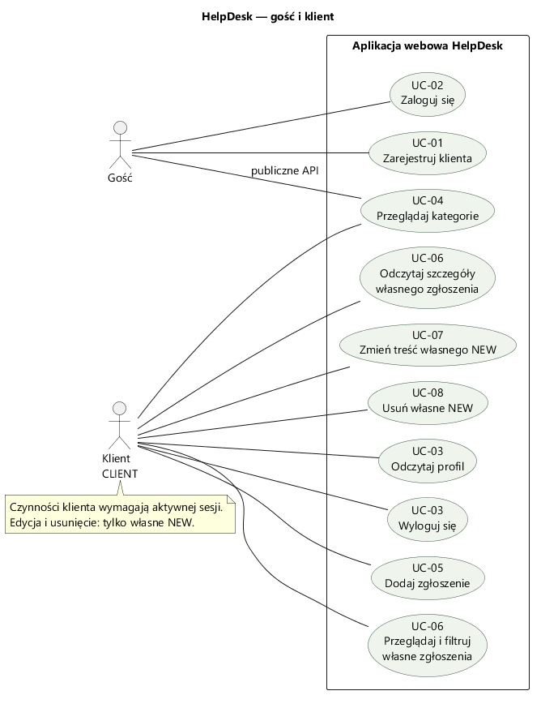
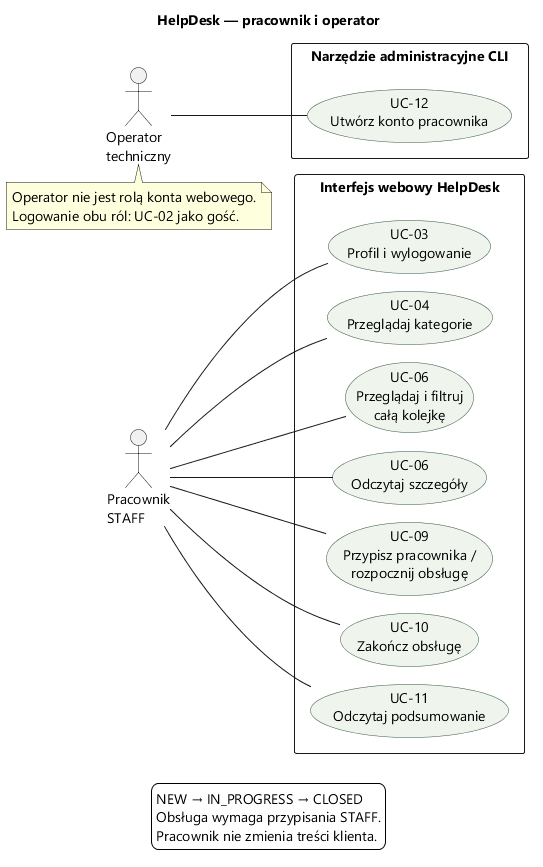
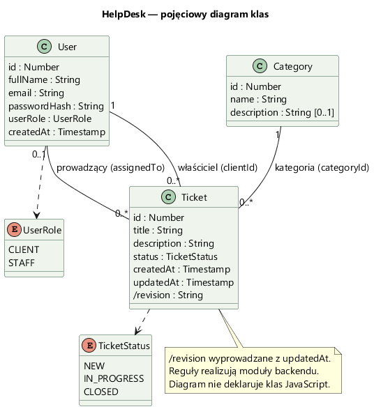
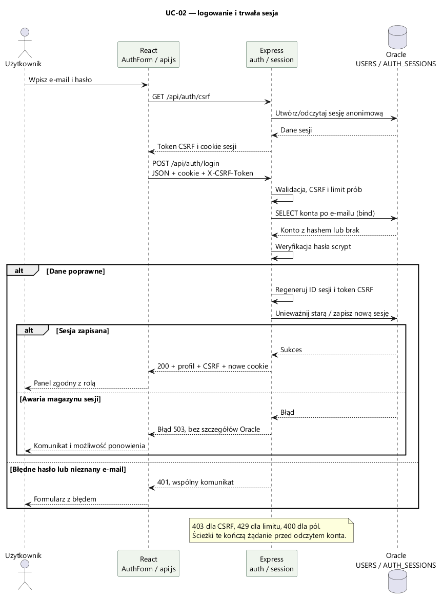
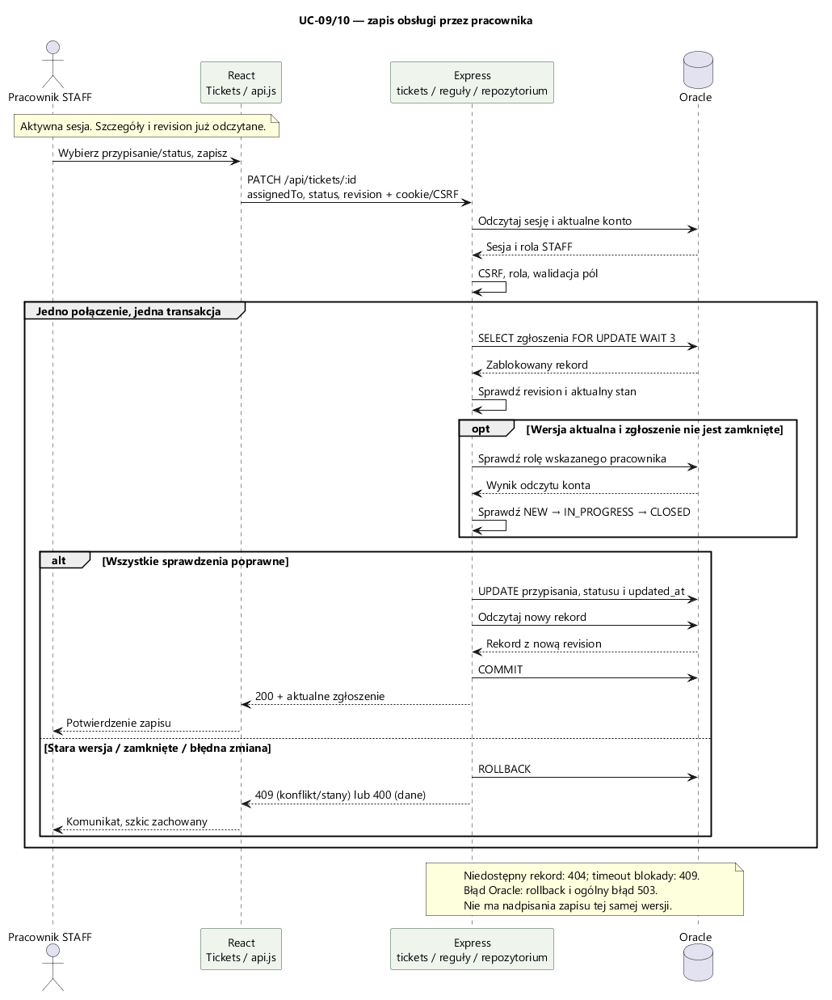

# Przypadki użycia i UML HelpDesk

Wersja 1.0, do przeglądu 12.10.2026. Scenariusze opisują istniejący zakres APP-01–APP-04 i wymagania [SRS](requirements.md).

## Aktorzy i diagramy

Gość rejestruje się, loguje i odczytuje publiczne kategorie. Klient pracuje na własnych zgłoszeniach. Pracownik zarządza całą kolejką. Operator tworzy konto pracownika przez CLI, poza interfejsem webowym. Operator nie jest rolą zapisaną w `USERS.user_role`.

Linia między aktorem i przypadkiem oznacza możliwość wykonania czynności. Warunek zalogowania opisujemy w scenariuszu, bez dodawania obowiązkowego logowania do każdej operacji: aktywna sesja już pozwala wykonywać kolejne działania.

## Katalog

| ID | Przypadek użycia | Aktor | Wymagania |
|---|---|---|---|
| UC-01 | Zarejestruj klienta | Gość | FR-01 |
| UC-02 | Zaloguj się | Gość, później klient/pracownik | FR-02 |
| UC-03 | Odczytaj profil / wyloguj się | Klient, pracownik | FR-03, FR-04 |
| UC-04 | Przeglądaj i wyszukaj kategorie | Gość przez API, klient/pracownik także w UI | FR-05 |
| UC-05 | Dodaj zgłoszenie | Klient | FR-06 |
| UC-06 | Przeglądaj i filtruj zgłoszenia / odczytaj szczegóły | Klient, pracownik | FR-07, FR-10, FR-12 |
| UC-07 | Zmień treść własnego nowego zgłoszenia | Klient | FR-08, FR-15, FR-16 |
| UC-08 | Usuń własne nowe zgłoszenie | Klient | FR-09, FR-15 |
| UC-09 | Przypisz pracownika i rozpocznij obsługę | Pracownik | FR-10, FR-11, FR-15 |
| UC-10 | Zakończ obsługę | Pracownik | FR-11, FR-15 |
| UC-11 | Odczytaj podsumowanie serwisu | Pracownik | FR-13 |
| UC-12 | Utwórz konto pracownika przez CLI | Operator | FR-14 |

FR-16 obejmuje błędy i stany formularzy we wszystkich właściwych przypadkach. FR-03 obejmuje również odtworzenie/wygaśnięcie sesji. UC-03 zbiera odczyt profilu i wylogowanie; na diagramie klienta są one dwoma powiązanymi przypadkami.

## Scenariusze szczegółowe

### UC-01 — rejestracja

Warunek: gość otworzył formularz, Oracle i API są dostępne. Rezultat: nowe konto `CLIENT`; użytkownik przechodzi do logowania, bez automatycznego nadania sesji zalogowanej.

1. Gość wpisuje imię i nazwisko, e-mail, hasło oraz jego powtórzenie.
2. UI sprawdza pola i zgodność haseł; pobiera CSRF i wysyła tylko dane wymagane przez API.
3. API normalizuje e-mail, waliduje dane i hashuje hasło.
4. Oracle zapisuje konto klienta; API odpowiada 201.
5. UI potwierdza utworzenie konta i pokazuje logowanie.

Alternatywy: błędne pola blokują wysłanie lub dają 400; istniejący e-mail daje 409; próba przesłania roli pracownika jest odrzucona. Błąd połączenia nie jest sukcesem rejestracji i pozwala ponowić próbę. Limit prób może dać 429.

### UC-02 — logowanie

Warunek: konto istnieje. Rezultat: nowy identyfikator sesji, profil i token CSRF; panel zgodny z rolą.

1. Użytkownik wpisuje e-mail i hasło.
2. UI pobiera token CSRF, a następnie wysyła login wraz z cookie.
3. API odczytuje konto i weryfikuje hash.
4. API regeneruje identyfikator sesji, zapisuje sesję w Oracle i ustawia cookie.
5. UI otwiera panel klienta albo pracownika.

Alternatywy: błędne hasło i nieznany e-mail dają wspólny komunikat 401; brak CSRF daje 403; przekroczenie limitu daje 429; nieudany zapis sesji nie zwraca udanego logowania.

### UC-05 — nowe zgłoszenie

Warunek: aktywna sesja `CLIENT`, istniejąca kategoria. Rezultat: nowe zgłoszenie tego klienta, `NEW`, daty z bazy, szczegóły w UI.

1. Klient wybiera „Nowe zgłoszenie”.
2. Wpisuje tytuł i opis oraz wybiera kategorię pobraną z API.
3. UI waliduje i wysyła POST z CSRF.
4. API sprawdza sesję/rolę, pola i kategorię; właściciela bierze z sesji.
5. Oracle zapisuje rekord. API zwraca 201 i zgłoszenie z wersją.
6. UI pokazuje zapisane szczegóły.

Alternatywy: błędne pola/kategoria dają 400; pracownik nie może tworzyć zgłoszeń i otrzymuje 403; wygaśnięcie sesji daje 401. Błąd zapisu pozostawia wpisaną treść w formularzu.

### UC-07/UC-08 — zmiana lub usunięcie

Warunek: zgłoszenie należy do klienta i nadal ma `NEW`. Rezultat zmiany: treść i wersja zaktualizowane; rezultat usunięcia: rekord znika z listy.

1. Klient odczytuje własne zgłoszenie z aktualnym `revision`.
2. Przy zmianie edytuje tytuł/opis/kategorię; przy usunięciu potwierdza okno dialogowe.
3. UI wysyła PATCH albo DELETE z CSRF i wersją.
4. API w transakcji sprawdza właściciela, blokuje rekord i weryfikuje wersję oraz stan.
5. Zapisuje/usuwa rekord i wykonuje COMMIT; UI pokazuje potwierdzenie.

Alternatywy: anulowanie usunięcia nie wysyła żądania; cudze/brakujące zgłoszenie daje 404; stara wersja lub rozpoczęta obsługa dają 409. Szkic edycji zostaje do czasu świadomego odświeżenia danych. Pobranie aktualnych danych zastępuje szkic — UI o tym informuje.

### UC-09/UC-10 — obsługa przez pracownika

Warunek: aktywna sesja `STAFF`, dostępne zgłoszenie i aktualna wersja. Rezultat: przypisanie i kolejny status zapisane; klient odczytuje tę samą zmianę.

1. Pracownik wybiera zgłoszenie z kolejki.
2. Wybiera istniejącego pracownika lub „Przypisz do mnie”.
3. Wybiera „W trakcie” dla `NEW` albo „Zamknięte” dla `IN_PROGRESS`.
4. UI wysyła PATCH z wersją i CSRF.
5. API blokuje rekord, sprawdza wersję, rolę wskazanego konta i kolejność statusów.
6. Oracle zapisuje zmianę i COMMIT. UI pokazuje nowy stan.

Alternatywy: można przypisać pracownika do `NEW` bez rozpoczynania; `NEW` może też pozostać nieprzypisane. Rozpoczęcie/zamknięcie bez pracownika albo pominięcie/cofnięcie statusu jest odrzucone. Stara wersja lub już zamknięty rekord dają 409. Zamknięcie jest końcowe; pracownik nie edytuje treści klienta.

### UC-12 — utworzenie pracownika

Warunek: operator ma dostęp do lokalnego terminala i konfiguracji backendu. Rezultat: konto `STAFF` w tabeli `USERS`.

1. Operator uruchamia `npm.cmd --prefix backend run staff:create` w folderze `helpdesk`.
2. Podaje imię, e-mail i dwukrotnie hasło; znaki hasła są ukryte.
3. Narzędzie waliduje i hashuje hasło, zapisuje pracownika.
4. Operator loguje się nowym kontem w UI w ramach odbioru.

Alternatywy: duplikat e-maila nie zmienia roli istniejącego konta; niezgodne hasła i niepoprawne dane nie tworzą konta. Konto Oracle `HELPDESK` pozostaje odrębnym użytkownikiem technicznym.

## Model dziedziny

`User`, `Category` i `Ticket` opisują obiekty dziedziny. Jedna klasa `User` posiada rolę; nie ma oddzielnych tabel ani klas dziedziczących `Client`/`Staff`. Krotności odpowiadają modelowi bazy. `revision` jest wartością DTO wyprowadzoną z `updatedAt`, a nie dodatkową kolumną.

Reguły i operacje realizują moduły funkcyjne backendu. Techniczna tabela sesji jest pokazana na ERD w [architekturze](architecture.md), poza diagramem klas dziedziny.

## Sekwencje

Sekwencje skupiają się na interakcjach. Szczegóły obsługi błędów, limitów i HTTP są w [opisie uwierzytelniania](authentication.md) i [zgłoszeń](tickets.md). Źródła diagramów oraz ich regeneracja: [diagrams/README.md](diagrams/README.md).
