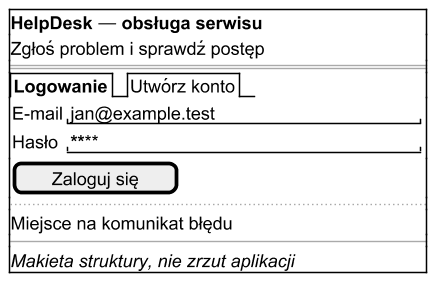
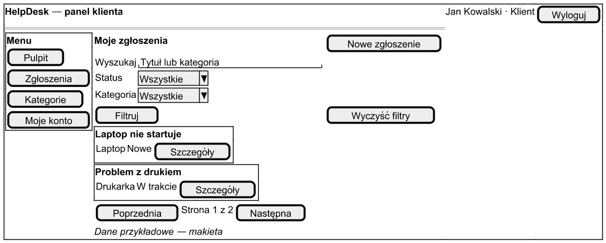
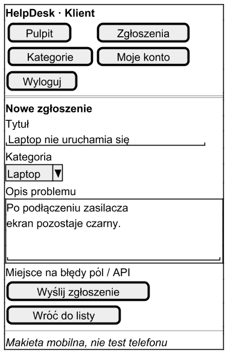

# Makiety interfejsu HelpDesk

DOC-01, 12.10.2026. Są to uproszczone makiety układu, odtworzone po implementacji APP-03/APP-04. Nie są zrzutami aplikacji ani dowodem testu w przeglądarce. Służą do przeglądu struktury, nawigacji i pól wymaganych na etapie projektowania.

Interaktywnym rezultatem jest istniejący frontend React. Uruchomienie `npm.cmd run dev` z folderu `helpdesk` udostępnia go pod `http://127.0.0.1:5173/`. Statyczne makiety uzupełniają ten widok o zapis projektu w repozytorium; zachowujemy rzeczywistą kolejność powstania kodu i dokumentacji.

## Logowanie

Gość widzi nazwę aplikacji, przejście między logowaniem i rejestracją, etykiety pól, przycisk i miejsce na błąd. Rejestracja rozszerza formularz o imię i nazwisko oraz powtórzenie hasła. Po poprawnej rejestracji następuje logowanie. Implementacja: `AuthForm.jsx`; wymagania FR-01/02/16.

## Panel klienta — komputer

Menu prowadzi do pulpitu, zgłoszeń, kategorii i konta. Klient ma przycisk nowego zgłoszenia, filtry, listę z odnośnikami do szczegółów i paginację. Pracownik zamiast przycisku dodawania ma obsługę całej kolejki, dodatkowy filtr przypisania i formularz przypisania/statusu w szczegółach. Implementacja: `Dashboard.jsx`, `Tickets.jsx`; wymagania FR-04–FR-13.

## Formularz zgłoszenia — telefon

Menu jest zwarte, formularz jednokolumnowy. Tytuł, kategoria i opis mają etykiety; błędy i stan zapisu są widoczne przy formularzu. Działający CSS zmienia układ przy 900 i 540 px. Makieta jest schematem, nie potwierdzeniem działania na fizycznym telefonie.

## Stany i odbiór

| Stan | Zachowanie istniejącego interfejsu |
|---|---|
| Oczekiwanie | Informacja o ładowaniu/zapisywaniu i ograniczenie powtórnego wysłania |
| Błąd pól | Komunikaty przy polach, fokus na błędne pole |
| Brak wyników | Komunikat i możliwość wyczyszczenia filtrów |
| Błąd API | Czytelny komunikat i ponowienie; bez wymyślonych liczników |
| Konflikt wersji | Informacja o zmianie zgłoszenia; szkic pozostaje do świadomego pobrania aktualnych danych |
| Usunięcie | Potwierdzenie; anulowanie pozostawia rekord |
| Rozpoczęte/zamknięte | Klient czyta dane; zamknięte zgłoszenie nie ma formularza zmian |
| Wygaśnięta sesja | Powrót do logowania |

Rzeczywisty interfejs ma kolorystykę kremową, zieloną i limonkową. Makiety pokazują rozmieszczenie, a kolory i rozmiary definiuje [styles.css](../frontend/src/styles.css). Etykiety/statusy pozostają czytelne słownie, bez polegania wyłącznie na kolorze.

Przegląd karty „1. Przegląd projektu graficznego”: porównaj makiety z działającą aplikacją, przejdź oba rodzaje kont i zapisz uwagi. Kontrola na 1440, 768 i 390 px w Chrome/Edge/Firefox oraz klawiaturą pozostaje w [protokole odbioru](acceptance.md). Źródła makiet Salt są edytowalne wraz z [diagramami](diagrams/README.md).
